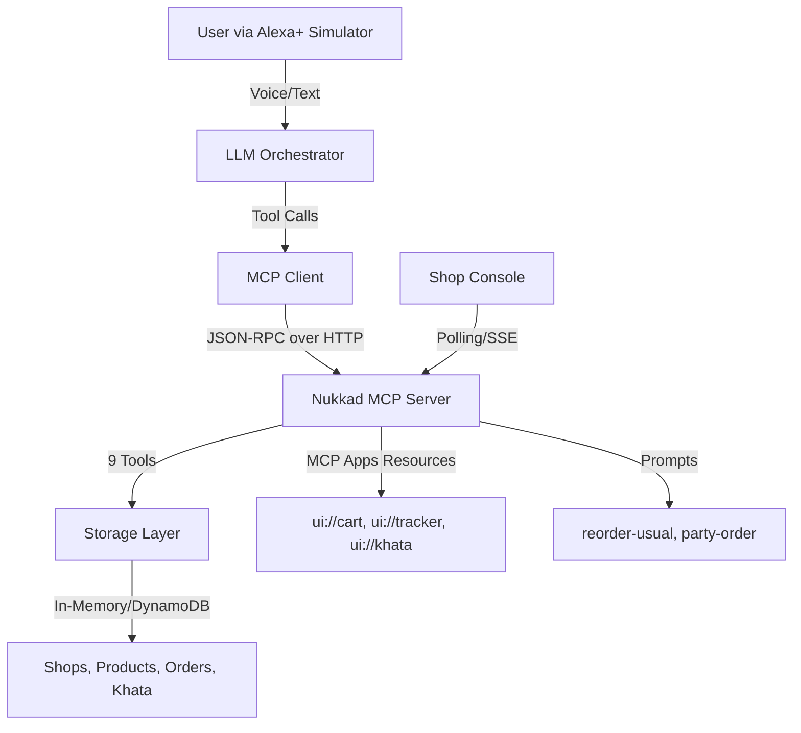

# Nukkad: The Corner Store, on Alexa+

**Multi-tenant MCP server for independent corner shops**

Built for the [Amazon "Build, Ship, Shape" Devpost hackathon](https://amazonappdev2026.devpost.com/), Alexa+ track.

## Pitch

Alexa+ is onboarding big brands like Priceline and Lyft. **Nukkad brings the long tail**: any independent corner store (a kirana in Bangalore, a bodega in Queens, a home bakery) becomes an Alexa+ add-on through one multi-tenant MCP server.

## Architecture



### Components

1. **packages/mcp-lambda-kit** — Reusable MIT library for running MCP 2025-11-25 Streamable HTTP servers on AWS Lambda
2. **packages/nukkad-mcp** — The main MCP server with 9 tools, MCP Apps resources, and prompts
3. **apps/web** — Next.js app with:
   - `/alexa` — Simulated Alexa+ host with real MCP client and LLM orchestration
   - `/shop/[id]` — Shop console for managing orders
4. **alexa-addon/addon.json** — Alexa+ manifest (ready for `alexa-ai deploy`)

## Quick Start

```bash
# Install dependencies
pnpm install

# Start everything (MCP server + web app)
pnpm dev

# Open the Alexa+ simulator
open http://localhost:3000/alexa
```

**No API keys needed in mock mode!** The default `.env` uses `MOCK_LLM=1`.

## Environment Variables

See `.env.example`:

- `MOCK_LLM=1` — Use scripted LLM (no keys needed, judges can test this way)
- `DEEPSEEK_API_KEY` — For DeepSeek provider (OpenAI-compatible)
- `AWS_*` — For Bedrock Nova provider (optional)
- `STORAGE_BACKEND=memory` — Use in-memory storage (or `dynamodb` for production)

## Features

### MCP Server (2025-11-25 Streamable HTTP)

**9 Tools:**
- `find_shops` — Find nearby shops by type
- `search_catalog` — Search products with Hinglish support (atta, doodh, chai)
- `get_usual` — Get customer's usual order
- `build_cart` — Build cart with quantity scaling (for parties)
- `check_stock_and_substitute` — Check stock and suggest substitutions
- `place_order` — Place multi-shop orders with khata payment
- `track_order` — Track order status
- `khata_balance` — Get store credit balance
- `khata_add_entry` — Add khata transaction

**3 MCP Apps Resources:**
- `ui://cart` — Shopping cart with editable quantities
- `ui://order-tracker` — Real-time order status
- `ui://khata` — Khata ledger with transaction history

**2 Prompts:**
- `reorder-usual` — Reorder usual items
- `party-order` — Scale order for party guests

**Response Time:** All tools < 500ms (Alexa+ requirement)

### Seed Data

- **3 shops:** Kirana, bakery, dairy
- **~90 products** with Hinglish aliases (e.g., "atta" = "aata" = "wheat flour")
- **2 customers** with order history and khata accounts

### The Headline Flow

Try saying:

> *"I'm having 6 friends over Saturday for chai and snacks. Get what I usually get, plus enough for six, and put it on my khata."*

The agent:
1. Recalls your usual order
2. Scales quantities for 7 people (you + 6 guests)
3. Checks stock across two shops (kirana + bakery)
4. Substitutes an out-of-stock item (asks once)
5. Checks khata credit limit
6. Places two orders
7. Shows an MCP Apps cart card
8. Updates both shop consoles in real-time

Also supports:
- Hinglish: *"ek kilo atta aur do packet doodh"*
- Tracking: *"Where's my order?"*
- Khata: *"What's my khata balance?"*

## Alexa+-Ready Checklist

- [x] MCP spec 2025-11-25 Streamable HTTP
- [x] Protocol version assertion (test in `mcp-lambda-kit`)
- [x] Tools under 500ms
- [x] OAuth 2.1 PKCE + RFC 9728 Protected Resource Metadata (in `mcp-lambda-kit`)
- [x] MCP Apps resources
- [x] Multi-shop, multi-step agentic workflow
- [x] Context across sessions (usual order, preferences)
- [x] Purchasing capabilities (orders, khata)
- [x] `addon.json` manifest

## Testing

```bash
# Run tests
pnpm test

# Build everything
pnpm build
```

## Deployment

### AWS Lambda (Production)

The MCP server can deploy to AWS Lambda + Function URL:

```bash
# Example with CDK
cdk deploy

# Or manually:
# 1. Build: pnpm --filter @nukkad/mcp-server build
# 2. Package dist/ and node_modules
# 3. Create Lambda with Node 22 runtime
# 4. Add Function URL with CORS
# 5. Set DynamoDB table name in env vars
```

### Vercel (Web App)

```bash
vercel deploy
```

## Project Structure

```
nukkad/
├── packages/
│   ├── mcp-lambda-kit/        # Reusable AWS Lambda MCP library (MIT, for Open Source prize)
│   └── nukkad-mcp/            # Main MCP server
│       ├── src/
│       │   ├── tools/         # 9 MCP tools
│       │   ├── storage/       # Interface + memory/DynamoDB implementations
│       │   └── data/          # Seed data
│       └── dist/              # Built output
├── apps/
│   └── web/                   # Next.js app
│       ├── src/
│       │   ├── app/
│       │   │   ├── alexa/     # Simulated Alexa+ host
│       │   │   ├── shop/[id]/ # Shop console
│       │   │   └── api/mcp/   # MCP API route
│       │   └── lib/           # MCP client, LLM providers
│       └── public/
├── alexa-addon/
│   └── addon.json             # Alexa+ manifest
├── FEEDBACK.md                # Product feedback for Amazon
├── FRICTION_LOG.md            # Friction log for 10% bonus
└── README.md                  # This file
```

## Technology Stack

- **Node 22** with TypeScript
- **pnpm** monorepo
- **MCP SDK** (TypeScript)
- **Next.js 15** (React 19, App Router)
- **Zod** for validation
- **Vitest** for testing
- **AWS** Lambda, DynamoDB (optional)

## Design

Sleek and premium. Black and white with red and green accents only. No yellow, orange, amber, or off-white.

## Disclosure

Inspired by DukaanOS, my earlier web storefront for Indian kirana shops built on Bolt (separate project, separate hackathon). **Nothing from it is in this repo.** All code here (MCP server, Alexa+ host, shop console, OSS library) was written October 18–23, 2026.

## License

MIT

## Contributing

This project was created for the Amazon hackathon. Contributions are welcome after judging!

## Author

Rohit Nandi

## Acknowledgments

- Amazon Alexa+ team for the MCP toolkit documentation
- Model Context Protocol community
- All the kiranas, bodegas, and corner stores that inspired this project
